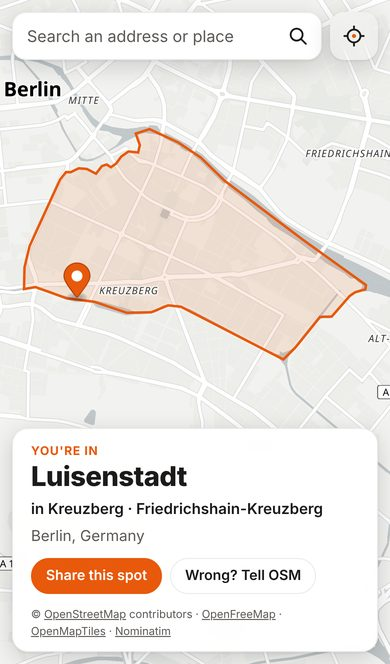
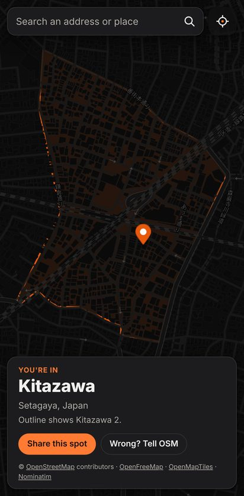

# WNIT: What Neighborhood Is This?

Open the page and get a map with a pin where you are and the **name of the neighborhood you're standing in**. It works anywhere OpenStreetMap knows the neighborhoods, which turns out to be most cities on Earth.

<p>
  
  
</p>

- 📍 Asks for your location, drops a pin, names the neighborhood ("in Montrose · Houston, Texas")
- ✋ Drag the pin or tap anywhere to check another spot; search an address, or paste `lat, lon`
- 🗺️ Outlines the neighborhood when OpenStreetMap has it as an area
- 🔗 Every spot has a shareable link: `…/#30.30600,-97.72900`
- 🌙 Dark mode, phone and desktop layouts, no ads, no tracking, no API keys

Research behind it (similar sites, data sources, a 51-city coverage test, domains): **[docs/RESEARCH.md](docs/RESEARCH.md)**. What's next, including Android/iOS and Garmin and Galaxy Watch: **[docs/ROADMAP.md](docs/ROADMAP.md)**.

## Run it

No build step and no dependencies to run.

```sh
npm start          # serves http://localhost:8000 (location works on localhost)
```

Any static file server works. To publish, turn on GitHub Pages for the repo root (see [ROADMAP.md → Phase 1](docs/ROADMAP.md#phase-1-put-it-online-an-evening-about-1015)).

## Test it

```sh
npm test           # unit tests (Node 18+, no installs): naming rules, geometry, rate limiting
npm run e2e        # browser tests with recorded OSM answers (needs Playwright, see below)
npm run e2e:live   # same idea against the real services, gently (~10 requests)
```

Playwright, once per machine: `npm i -D playwright && npx playwright install chromium`

## How it works

```
browser GPS ──► pin on the map (MapLibre + OpenFreeMap tiles)
            └─► Nominatim /reverse (zoom 18)  ──► src/hood.js picks the best name
                Nominatim /reverse (zoom 15/14, polygons) ──► outline, if OSM has one
```

- **`src/hood.js`** turns OpenStreetMap's address levels (`neighbourhood`, `quarter`, `suburb`, `city_district`…) into one answer. It pushes admin codes down ("Manhattan Community Board 7", "RW 05", "Kitazawa 2", subdivision plats like "Brumback's Addition") so "Upper West Side" and "Kitazawa" win, and it checks that an outline really contains the pin. Pure JS, so it can be reused in a server or API later.
- **`src/nominatim.js`** is a polite client: one request at a time, at least 1.1 s apart, cached, stale requests dropped, and it sends your browser's languages so you get "Zamalek" rather than "الزمالك".
- **`src/app.js`** wires up the map, pin, search, card and share button.
- MapLibre GL JS 5.24.0 is vendored in `vendor/` (BSD-3-Clause), so the site has no third-party script CDN.

## Rules of the free services (please keep them)

- **Nominatim** ([policy](https://operations.osmfoundation.org/policies/nominatim/)): at most 1 request/second **for the whole app**, attribution shown, no search-as-you-type. Each lookup uses 1–3 requests, triggered by the user. If WNIT gets real traffic, put a caching API in front, or point `baseUrl` in `src/nominatim.js` at LocationIQ or a self-hosted Nominatim (Roadmap, Phase 3).
- **OpenFreeMap**: free, no key, attribution required (shown in the map corner, or in the card on phones).
- **Privacy:** there is no WNIT server. Coordinates you look up go only to OpenStreetMap's Nominatim, to get the name.

## Credits

Map data and neighborhood names © [OpenStreetMap](https://www.openstreetmap.org/copyright) contributors (ODbL). Tiles by [OpenFreeMap](https://openfreemap.org/) / [OpenMapTiles](https://openmaptiles.org/). Geocoding by [Nominatim](https://nominatim.org/). The test fixtures in `tests/fixtures/` are recorded Nominatim responses, also © OpenStreetMap contributors.
