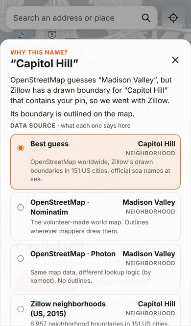
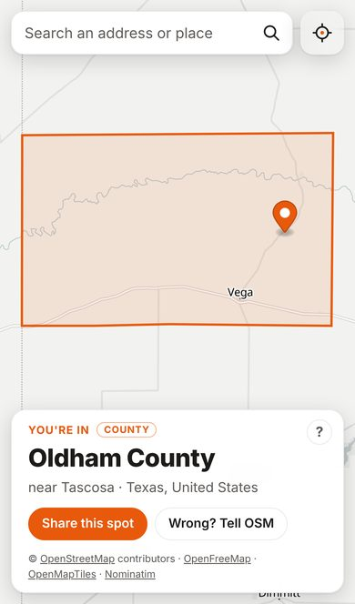
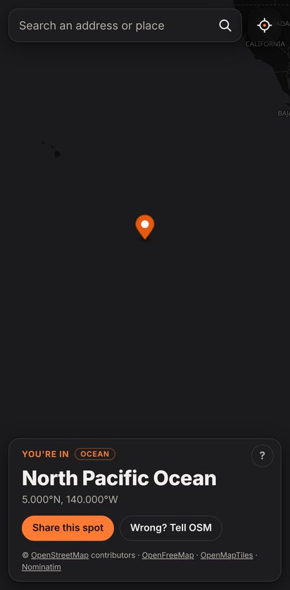

# WNIT: What Neighborhood Is This?

Open the page and get a map with a pin where you are and the **name of the neighborhood you're standing in**. Out in the countryside it names the county instead, and at sea the ocean or sea. You can compare what five different data sources say about the same spot.

<p>
  
  
  
</p>

- 📍 Asks for your location, drops a pin, names the neighborhood: by default, the name **printed on the map** nearest your pin ("Third Ward · Houston, Texas")
- 🪜 **Always an answer:** neighborhood → the town you're in → the county (with the nearest town) → state → country → ocean/sea
- ❓ The **?** button explains *why* that name, lists every level the spot belongs to, and **compares the sources** side by side. Pick one to switch.
- 🗺️ Outlines the area it names (neighborhood, town or county), using OpenStreetMap shapes plus Zillow's US boundaries
- ✋ Drag the pin or tap anywhere; search an address, or paste `lat, lon`
- 🔗 Shareable links: `…/#30.30600,-97.72900` (add `?source=esri` to share a source choice)
- 🌙 Dark mode, phone + desktop layouts, no ads, no tracking, no API keys

**New here? Start with [docs/HOW-IT-WORKS.md](docs/HOW-IT-WORKS.md)**, a plain-language walkthrough of the whole thing. Research behind it (similar sites, data sources, coverage tests, domains): **[docs/RESEARCH.md](docs/RESEARCH.md)**. What's next, including phone apps and Garmin / Galaxy Watch: **[docs/ROADMAP.md](docs/ROADMAP.md)**.

## Data sources

| Source | Covers | Outlines | How it's used |
|---|---|---|---|
| **Best guess** (default) | Everywhere | Yes | The map label nearest the pin; outlines from OSM or Zillow boundaries with that name; without a label, OSM's address lookup (Zillow breaks ties); sea names at sea |
| Map labels (OpenStreetMap) | Cities worldwide | No (points) | Read from the same vector tiles the map draws, so usually no extra download |
| OpenStreetMap · Nominatim | Everywhere | Where mappers drew them | Public API, ≤ 1 request/s |
| OpenStreetMap · Photon (komoot) | Everywhere | No | Public API |
| Zillow neighborhoods (2015) | 6,957 neighborhoods in 151 US cities | Yes | Static files in `data/zillow/`, no API |
| Esri World Geocoder | Everywhere | No | Public endpoint without a key; experimental |
| IHO Sea Areas (Marine Regions) | All oceans and seas | (not drawn) | Static file `data/seas.json`, only used when nothing on land fits |

## Run it

No build step and no dependencies to run.

```sh
npm start          # serves http://localhost:8000 (location works on localhost)
```

Any static file server works. Where to put it for real: **[docs/HOSTING.md](docs/HOSTING.md)**.

## Lookup cache (optional, AWS)

`server/` is a small AWS app (Lambda + DynamoDB, deployed with one `sam deploy`). Every visitor's OpenStreetMap lookups go through one shared cache and one polite 1-request-per-second limit, as Nominatim's policy asks. Repeat lookups come back in milliseconds. To use it, deploy it ([server/README.md](server/README.md)) and paste its URL into `<meta name="wnit-api">` in `index.html`. Left empty, the site talks to the free services directly. To try it locally: `npm run api` and open `http://localhost:8000/?api=http://localhost:8787`.

## Test it

```sh
npm test           # 56 unit tests (Node 18+, no installs): naming rules, every source, map labels, the fallback ladder, the cache
npm run e2e        # 13 browser scenarios with recorded answers (needs Playwright, see below)
npm run e2e:live   # a few scenarios against the real services, gently
```

Playwright, once per machine: `npm i -D playwright && npx playwright install chromium`

## How it works

```
pin ──► chosen source ──► Report {neighborhoods, town (in / near), county, state, country, water}
                               │
                               ├─► answerFor(): the first level that fits → "You're in · county: Oldham County"
                               ├─► explain():  plain-language reasons for the "?" panel
                               └─► findOutline(): Zillow / OSM polygon for that level → drawn on the map
```

- **`src/sources.js`**: one adapter per source, all returning the same report shape. It also holds the "best guess" merge and the outline finder. OSM checks whether you're actually *inside* a town or only near it, with one lookup at the town's zoom level whose polygon doubles as the outline.
- **`src/labels.js`**: reads the neighborhood labels out of the map's vector tiles (a ~100-line tile reader) and picks the one nearest the pin.
- **`src/answer.js`**: the fallback ladder, the explanations, and the "this spot is part of" list.
- **`src/hood.js`**: reads OSM's address levels, demotes admin codes ("Manhattan Community Board 7", "RW 05", "Kitazawa 2"), and does point-in-polygon geometry.
- **`src/nominatim.js`**: polite fetching: one request at a time, spaced out, cached, stale requests dropped.
- **`src/app.js`**: the map, card, "?" panel, search and share.
- **`scripts/build-data.mjs`**: rebuilds `data/` from npm packages:
  ```sh
  npm pack hoods@1.2.0 oceans-seas.geojson@0.5.0 && mkdir -p /tmp/hoods /tmp/seas
  tar xzf hoods-1.2.0.tgz -C /tmp/hoods && tar xzf oceans-seas.geojson-0.5.0.tgz -C /tmp/seas
  node scripts/build-data.mjs /tmp/hoods/package/data /tmp/seas/package/oceans-seas.geo.json
  ```

## Rules of the free services (please keep them)

- **Nominatim** ([policy](https://operations.osmfoundation.org/policies/nominatim/)): at most 1 request/second **for the whole app**, attribution shown, no search-as-you-type. A lookup uses 1–3 requests, triggered by the user; the "?" comparison reuses them. If WNIT gets real traffic, put a caching API in front (Roadmap, Phase 3).
- **Photon / Esri** are only queried when you pick them or open the "?" comparison. Esri's keyless endpoint is undocumented territory for public apps, so it's labeled experimental.
- **Privacy:** there is no WNIT server. The coordinates you look up go to the services above to get names; Zillow and sea lookups happen in your browser.

## Credits and licenses

Map data and names © [OpenStreetMap](https://www.openstreetmap.org/copyright) contributors (ODbL). Tiles by [OpenFreeMap](https://openfreemap.org/) / [OpenMapTiles](https://openmaptiles.org/). Geocoding by [Nominatim](https://nominatim.org/), [Photon](https://photon.komoot.io/) (komoot) and [Esri](https://www.esri.com/). Neighborhood boundaries © Zillow, [CC BY-SA 3.0](https://creativecommons.org/licenses/by-sa/3.0/) (via the [hoods](https://github.com/zeke/hoods) package), so `data/zillow/` is CC BY-SA 3.0 too. Sea areas: IHO Sea Areas v3, Flanders Marine Institute (2018), [marineregions.org](https://www.marineregions.org/), CC BY 4.0. MapLibre GL JS (BSD-3-Clause) is vendored in `vendor/`. The test fixtures are recorded responses from those services.
