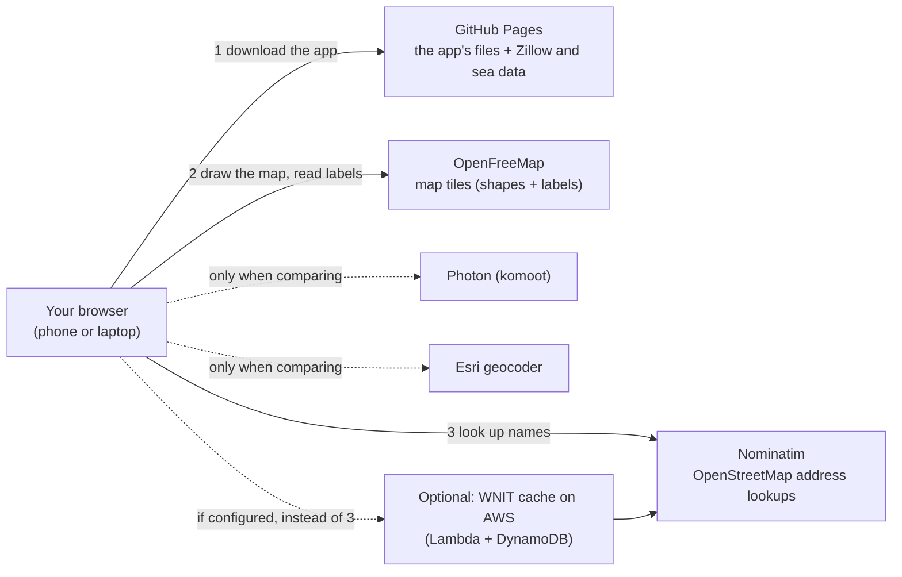
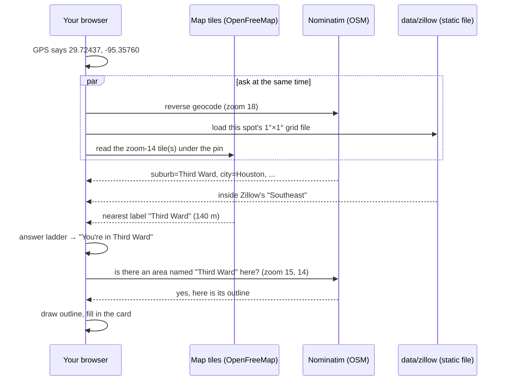

# How WNIT works: a walkthrough

This explains the whole project, from "you open a web page" down to how a single neighborhood name gets picked. It assumes you're comfortable with ideas but not with any particular technology. New terms are explained as they show up; there's a [glossary](#glossary) at the end and [experiments](#try-it-yourself) you can run.

---

## The one-paragraph version

WNIT is a web page. When you open it, your browser downloads a handful of files and runs them; **there is no WNIT server doing work for you**. The page asks your phone where you are (latitude and longitude). It draws a map from free map data, then asks several free sources the same question: *what is this place called?* It applies a few rules to pick the best answer ("You're in Third Ward"), draws that neighborhood's outline when one exists, and can show you why it chose that name and what each source said. An optional piece, the *lookup cache*, runs on Amazon's cloud and remembers answers so everyone shares them.

---

## 1. The big picture

Some vocabulary for that picture:

- **Your browser** (Chrome, Safari, Firefox) is a program that downloads files from the internet and runs them. Web pages are made of three kinds of files: **HTML** (the structure: "there's a search box, a card, a map"), **CSS** (the looks: colors, sizes, rounded corners), and **JavaScript** (the behavior: "when the pin is dragged, look up the new spot"). WNIT is mostly JavaScript.
- **A server** is a computer on the internet that answers requests. When your browser wants something, it sends an **HTTP request** to a URL; the server sends back a **response**, a web page, an image, or **data**.
- **An API** is a URL that answers with data instead of a web page. For example, `https://nominatim.openstreetmap.org/reverse?lat=30.306&lon=-97.729&format=jsonv2` answers "what's at this coordinate?" in **JSON**, a simple text format for data that looks like `{"suburb": "Hyde Park", "city": "Austin"}`.
- **A static site** is a website whose server only hands out files and never runs code for you. WNIT is one, hosted on **GitHub Pages** for free. All the thinking happens in *your* browser.

---

## 2. What happens when you open the page

### Step 1: the browser downloads the app

`index.html` is the page itself. It pulls in `style.css`, a mapping library (`vendor/maplibre-gl-5.24.0/`), and the app's own code in `src/`. Nothing is compiled or "built"; the files in the repository are exactly the files your browser runs.

### Step 2: "where am I?"

The app calls the browser's **Geolocation API** (`navigator.geolocation`). Your phone answers from GPS, Wi-Fi or cell towers and gives back a latitude, a longitude, and an accuracy ("±25 m"). Browsers only allow this on secure (HTTPS) sites, and only after you tap "Allow". If you say no, the app asks you to search or tap the map instead.

**Latitude/longitude** are the world's address system: degrees north/south of the equator and east/west of Greenwich. `30.30600, -97.72900` is a spot in Austin. Five decimal places is about one meter.

The app writes the spot into the page's address: `…/wnit/#30.30600,-97.72900`. The part after `#` is a **hash**. The browser doesn't send it to any server, but the app reads it, so a copied link opens the same spot. That's the "Share this spot" button.

### Step 3: drawing the map

The map uses **MapLibre GL JS**, an open-source library that draws maps with your device's graphics chip (WebGL). The map data comes from **OpenFreeMap**, a free service that serves map **tiles**.

**What's a tile?** Imagine the whole world as a square picture. At **zoom 0** it's one tile. At zoom 1 you cut it into 2×2 tiles, at zoom 2 into 4×4, and so on: zoom *z* has 2^z × 2^z tiles. The map only downloads the few tiles you're looking at. At zoom 14 (the most detailed level OpenFreeMap has), one tile covers about 2 km on a side.

These are **vector tiles**: instead of a picture, each tile holds *data* (shapes of roads, buildings, water, and labels with their positions), and your browser draws them. That matters a lot, because **we can read the labels out of the same tiles** (step 4).

### Step 4: what is this place called?

This is the heart of WNIT. It asks several **sources**, each turning a coordinate into place names. Turning a coordinate into a name or address is called **reverse geocoding**; turning an address into a coordinate, like the search box does, is **forward geocoding**.

| Source | What it is | Where it lives |
|---|---|---|
| **Map labels** | The neighborhood names printed on the map, from OpenStreetMap | Inside the map tiles from step 3 |
| **Nominatim** | OpenStreetMap's official geocoder | Free public API, max **1 request per second** |
| **Zillow** | 6,957 neighborhood *boundaries* in 151 US cities (2015) | Files shipped with this site in `data/zillow/` |
| **Photon** | A different geocoder built on the same OpenStreetMap data | Free public API (komoot) |
| **Esri** | A commercial geocoder | Free endpoint, only used when you open the comparison |
| **IHO Sea Areas** | Official names of oceans and seas | A file shipped with the site, `data/seas.json` |

**OpenStreetMap (OSM)** is the "Wikipedia of maps": millions of volunteers draw roads, buildings, parks and places. A neighborhood can be mapped two ways:

- as a **point** (a single dot tagged `place=neighbourhood` with a name). This is easy to add and very common in the US.
- as an **area** (a polygon tracing its boundary). This is more work and common in Europe and Latin America.

That one fact explains a lot of WNIT's behavior. Points give us *names*, areas give us *outlines*.

#### How each source answers

- **Map labels** (`src/labels.js`): the app takes the tile(s) under your pin and reads the `place` layer, a list of labels with positions and a class (`neighbourhood`, `quarter`, `suburb`). Then it picks the **nearest** one. Bigger areas count as a little closer: a *suburb* label 140 m away beats a small *neighbourhood* label 570 m away, which is how Houston's "Third Ward" wins. It reads the tile format itself (protobuf, a compact binary format) with about 100 lines of code, checked against Mapbox's official decoder.
- **Nominatim** (`src/nominatim.js`, `src/sources.js`): the app asks for the address at the coordinate and gets back levels like `neighbourhood`, `suburb`, `city`, `county`, `state`, `country`. In `src/hood.js` it throws out things that are boundaries but not names people use: "Manhattan Community Board 7", "RW 05" (an Indonesian admin unit), "Kitazawa 2" (a Tokyo block number).
- **Zillow** (`data/zillow/`): the US is cut into a grid of 1°×1° squares, one file per square that has data. The app downloads only the square your pin is in (from under 1 KB to about 250 KB), then checks which neighborhood shape contains the pin. That check is called **point-in-polygon**, and the trick is cute: draw a line from the point straight to the right and count how many times it crosses the shape's edge. Odd means inside, even means outside.
- **Seas**: only when nothing on land fits, the app does the same point-in-polygon test against 101 ocean and sea shapes.

### Step 5: the answer ladder

Neighborhoods are fuzzy, and plenty of places have none: a ranch, a highway, the Pacific. So the answer walks down a ladder (`src/answer.js`) and takes the **first rung that fits**:

1. **Neighborhood**: "You're in · neighborhood: Third Ward"
2. **The town you're actually in**: "You're in · city: Plano"
3. **Named water**: "You're in · ocean: North Pacific Ocean"
4. **County**: "You're in · county: Oldham County, near Tascosa"
5. **State**, then **country**

Rung 2 has a subtle trap. Out in the country, sources happily say "town: Tascosa" because it's the *nearest* town, even if it's miles away. So the app makes one extra check: it asks Nominatim for that town's boundary and tests whether the pin is inside it. If not, the app says "near Tascosa" and drops to the county. As a bonus, the same check hands back the county's outline.

The **Best guess** source (the default) combines the others:

- the **nearest map label** names the spot, because those are the names people use, printed right on the map;
- the **outline** comes from an OSM or Zillow boundary *with the same name*, or else from a differently named boundary around the pin, clearly labeled ("Zillow's boundary, which it calls “Rmma”");
- if there's no label nearby, Nominatim's answer is used, with Zillow breaking ties in US cities.

### Step 6: the outline

`createOutlineFinder` in `src/sources.js` looks for a shape to draw, cheapest option first:

1. A shape the source already has (Zillow's polygons are in the file we downloaded).
2. Zillow's shape, if the name matches (for US answers from other sources).
3. Ask Nominatim for the area at the right zoom: 15 and 14 for neighborhoods, 10–14 for towns, 8 for counties, 5 for states. It then checks that the returned shape really contains the pin, since Nominatim sometimes returns a neighbor.

If it finds one, the map draws it in orange and zooms to fit.

### Step 7: the "?" panel

Tap **?** and the app shows:

- **why** it chose the name (`explain()` in `src/answer.js`),
- every level the spot belongs to,
- what **every source** says.

Each source is asked once per spot and its answer remembered, so switching sources is instant. Your choice is saved in the browser and can be shared with `?source=zillow` in the link.

---

## 3. Why the sources disagree (and why that's fine)

"Neighborhood" isn't an official thing in most places. Each source reflects who made it:

- **OpenStreetMap labels**: placed by local volunteers, so they're usually the names people say: Mueller, Third Ward, Capitol Hill.
- **City planning areas** (what Zillow used in Austin): official, sometimes odd. "RMMA" is the Robert Mueller Municipal Airport planning area.
- **Real-estate boundaries** (Zillow): drawn for listings; some are coarse ("Southeast" Houston).
- **Commercial geocoders** (Esri): their own data mix. Esri calls the Gulf of Mexico the "Gulf of America".

A good lesson came from Houston. A rule meant to hide admin codes treated any name containing "ward" as one, so "Third Ward" got thrown out. Rules that look sensible on a few examples can break on real names. Now the rule only rejects *numbered* wards, and a test makes sure "Third Ward" and "Fifth Ward" survive.

---

## 4. Being a good guest on free services

Most of WNIT runs on services that are free because they're generous, so it follows their rules:

- **Rate limits.** Nominatim allows at most one request per second for the *whole app*, all visitors combined. `createPoliteFetcher` in `src/nominatim.js` sends requests one at a time, at least 1.1 s apart, remembers answers, and cancels stale ones (when you drag the pin again before the last answer arrives).
- **Attribution.** Data licenses require credit: © OpenStreetMap contributors (ODbL), Zillow (CC BY-SA), Marine Regions (CC BY). That's the small print on the card and the map.
- **No scraping.** Nothing ever pre-fetches or sweeps an area. Only lookups that real people make are sent. Esri's terms forbid storing its answers, so the app never does.

---

## 5. The lookup cache (the AWS part)

**The problem:** the 1-per-second limit is shared by everyone. Picture a librarian who can answer one question per second for the whole school; if 30 students ask at once, most must wait or get turned away.

**The fix:** keep a notebook of answers already given. Before bothering the librarian, check the notebook. That notebook is a **cache**, and `server/` is a tiny program that keeps one in the cloud.

The cloud pieces, all on **Amazon Web Services (AWS)**:

- **Lambda**: a function that runs only when a request arrives. There's no computer to rent or maintain, and you pay per request; the first million a month are free. Ours is `server/src/handler.mjs`, with the logic in `server/src/core.mjs`.
- **Function URL**: the public web address that triggers the function.
- **DynamoDB**: a database that stores items by key. The key is the normalized question, the value is the zipped answer, and each answer expires after 30 days so map fixes show up.
- **SAM template** (`server/template.yaml`): a text file that *describes* all of the above. One command, `sam deploy`, creates everything, and `sam delete` removes it. This idea is called **infrastructure as code**.

Two neat details:

- **Nearby pins share answers.** The cache rounds coordinates (about 11 m at street level, 110 m for towns, 1 km for counties), so two people on the same block hit the same notebook entry.
- **One global queue, even with many copies running.** Lambda may run several copies of the function at once, and they must still take turns with Nominatim. Each copy reads the "next free second" from DynamoDB and tries to move it 1.1 s later, *but only if nobody else moved it in the meantime* (a **conditional write**). If someone did, it reads again and retries. It's like taking a ticket at a deli counter. Computer scientists call this **optimistic locking**.

The site uses the cache only if you put its URL in `index.html` (`<meta name="wnit-api">`). Otherwise it talks to the free services directly.

---

## 6. Where everything lives (the code map)

| Path | What it is |
|---|---|
| `index.html`, `style.css` | The page and its looks |
| `src/app.js` | The conductor: map, pin, search, card, "?" panel |
| `src/sources.js` | One adapter per data source; Best guess; outline finder |
| `src/labels.js` | Reads labels out of map tiles; nearest-label rules |
| `src/answer.js` | The answer ladder and the plain-English explanations |
| `src/hood.js` | OSM address parsing, admin-code filter, geometry (point-in-polygon) |
| `src/nominatim.js` | Polite networking (queue, spacing, cache) |
| `src/config.js` | Where to send lookups (direct, or your cache) |
| `data/` | Zillow grid files and ocean shapes, built by `scripts/build-data.mjs` |
| `vendor/` | Third-party code we ship as-is (MapLibre) |
| `server/` | The AWS lookup cache (code + template + deploy guide) |
| `tests/` | Automated tests and recorded answers ("fixtures") |
| `docs/` | This walkthrough, research, roadmap, hosting options |

Most of `src/` is **pure functions**: give them data and they return data, without touching the screen or the network. That makes them easy to test and lets the same code run in the browser, in tests, and on the server.

---

## 7. How we know it works: tests

A **test** is code that runs other code and checks the result, like `assert.equal(answer.title, 'Third Ward')`. There are two kinds here.

- **Unit tests** (`npm test`, 56 of them): small checks of individual functions. They run on **Node.js**, which is JavaScript outside the browser, using its built-in test runner. They use **fixtures**: real answers recorded once from Nominatim, Photon, Esri and OpenFreeMap and saved in `tests/fixtures/`. Tests never touch the internet, so they're fast, repeatable, and don't burden the free services.
- **End-to-end tests** (`npm run e2e`, 13 scenarios): a real browser (Chromium, driven by a tool called **Playwright**) opens the actual page, fakes a GPS position, clicks things, and checks what's on screen. For example: open the Texas panhandle and expect "Oldham County, near Tascosa"; open "?" and expect six sources to answer. During testing, network requests are intercepted and answered from the fixtures.

There's also a "live" mode (`npm run e2e:live`) that uses the real services, used sparingly to check reality hasn't drifted from the recordings.

---

## 8. How it gets onto the internet

- **git** records the project's history as a series of **commits** (snapshots with a message). **GitHub** hosts that history online.
- A **branch** is a line of work. `main` is the official version. Claude works on `ccr-c978b714-fpli2j` and proposes changes through **pull requests** (PRs), which you review and merge into `main`.
- **GitHub Pages** publishes `main` as a website. Every merge redeploys it within a minute or so, at `www.jessepye.com/wnit/` (your GitHub Pages custom domain).
- The AWS cache is deployed separately from your own computer with `sam deploy` (see `server/README.md`).

---

## Try it yourself

1. **Watch the network.** Open the site, open your browser's developer tools (`F12`, or `Cmd+Option+I` on a Mac), and choose the **Network** tab. Drag the pin and watch the requests: tiles (`.pbf`), `nominatim…/reverse`, Zillow cells (`data/zillow/cells/…`).
2. **Poke the data.** In the **Console** tab, type `wnit.answer` or `wnit.report` to see what the app decided, as data.
3. **Switch sources from the link:** add `?source=zillow`, `?source=labels` or `?source=esri` before the `#`.
4. **Run it locally:** with Node.js installed, run `npm start`, then open `http://localhost:8000`.
5. **Break something on purpose.** In `src/labels.js`, change `suburb: 0.6` to `suburb: 1`, run `npm test`, and see which tests fail and why. (Then change it back.)

---

## Glossary

- **API**: a URL that returns data (usually JSON) instead of a web page.
- **Attribution**: the credit a data license requires you to show.
- **Cache**: saved answers, reused instead of asking again.
- **CORS**: the browser rule deciding which websites may read responses from another site's server. The cache's `AllowedOrigins` setting lists who may.
- **Fixture**: a recorded input or answer used by tests.
- **Geocoding**: address → coordinates. **Reverse geocoding**: coordinates → address or names.
- **HTTP request / response**: the browser asking a server for something, and the reply.
- **JSON**: a text format for structured data: `{"name": "Hyde Park"}`.
- **Lambda**: AWS's run-a-function-on-demand service.
- **ODbL**: OpenStreetMap's data license (share-alike: derived databases must stay open).
- **Point-in-polygon**: deciding whether a point is inside a shape (count edge crossings).
- **Rate limit**: the maximum request speed a service allows.
- **Static site**: a site whose server only serves files; all code runs in the browser.
- **Tile / vector tile**: one square piece of the map at one zoom level; "vector" means it holds shapes and labels as data, not a picture.
- **Zoom level**: how far in the map is; each level splits every tile into four.
